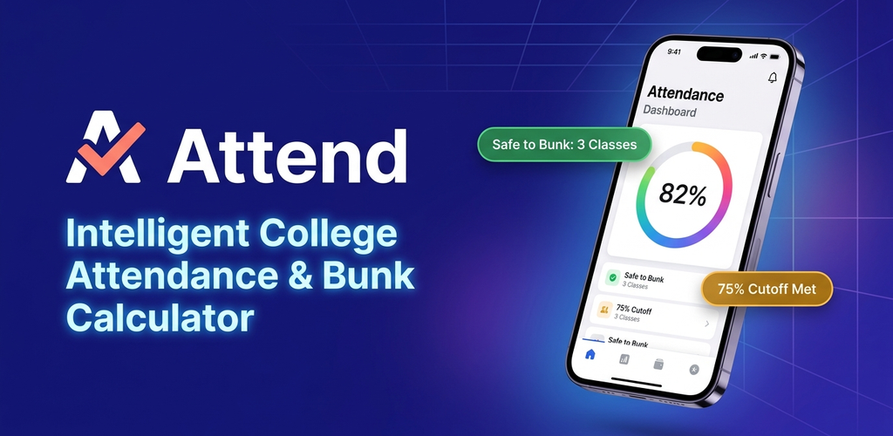
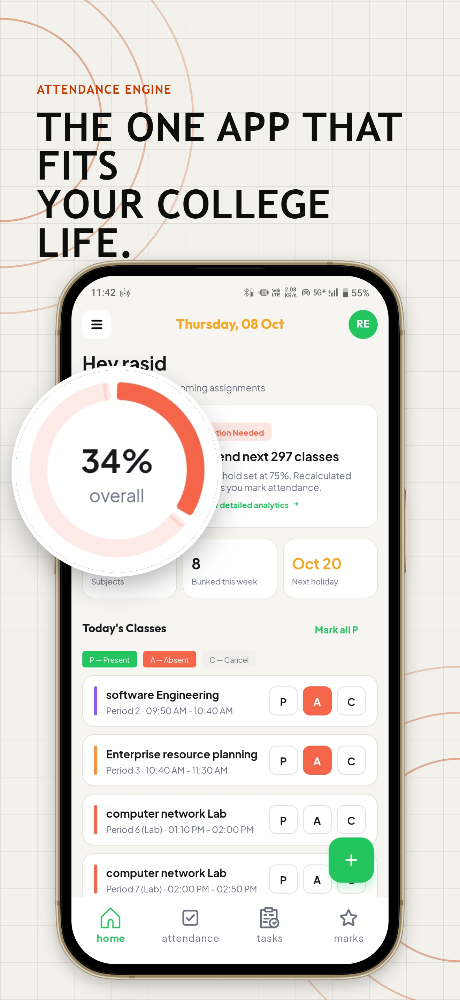
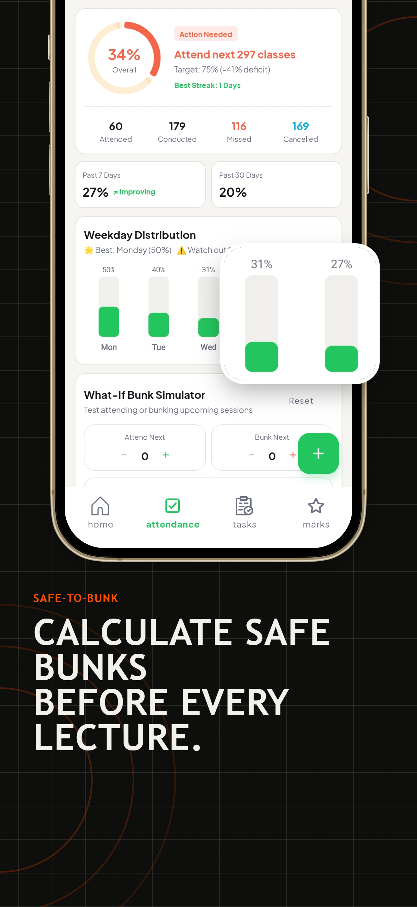
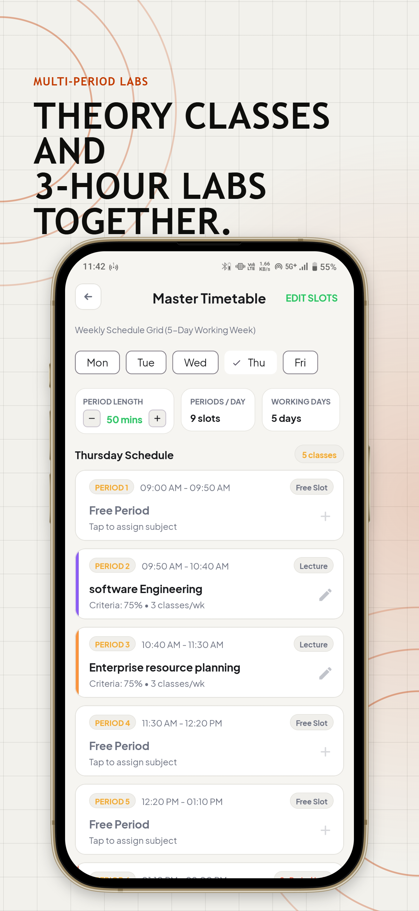
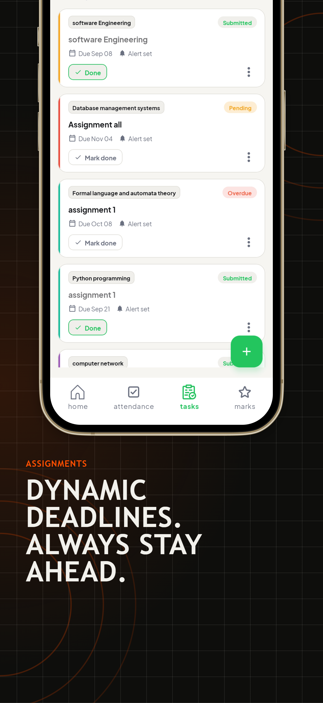
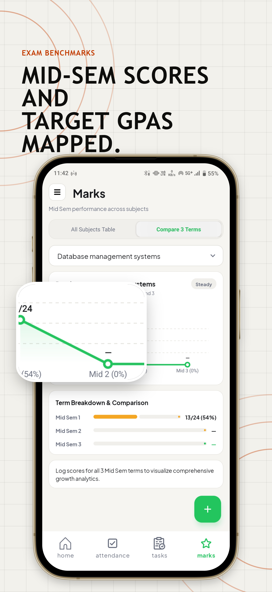
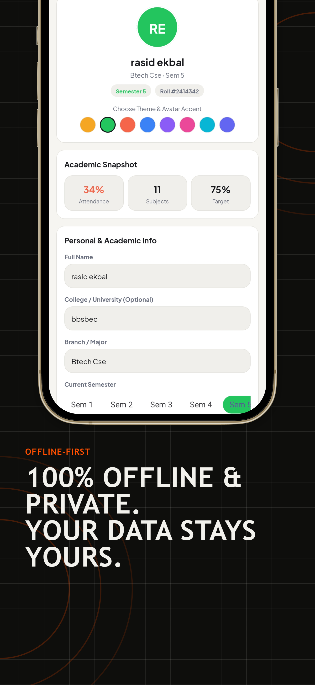

# Attend — College Attendance Tracker & Academic Hub

<p align="center">
  
</p>

<p align="center">
  <strong>The intelligent, offline-first attendance engine and academic planner built natively for Android.</strong><br>
  Track multi-period schedules and labs, calculate real-time safe-to-bunk margins, manage assignments with dynamic deadlines, track mid-sem examination scores, and customize your theme with zero cloud dependency.
</p>

<p align="center">
  
  
  
  
  
  
</p>

<p align="center">
  
</p>

---

## 📱 Visual Showcase

<div align="center">

| 1. Never Fall Short of Attendance | 2. Precision Timetable & 2-Hour Labs | 3. Smart Safe-to-Bunk Predictions |
| :---: | :---: | :---: |
|  |  |  |

<br/>

| 4. Assignments & Deadline Reminders | 5. Mid-Sem Marks & Performance Hub | 6. 1-Tap Home Screen Widgets & Theming |
| :---: | :---: | :---: |
|  |  |  |

</div>

---

## 🌟 Key Features

### 1. 🧮 Period-Weighted Attendance Engine

- **Multi-Period & Multi-Lab Awareness**: Accurately weighs attendance records against the number of scheduled class/lab periods on any given day (e.g., consecutive lab periods count proportionally towards total attended and conducted hours).
- **Intelligent "Safe to Bunk" Math**: Real-time formula calculates exactly how many consecutive sessions you can skip without falling below your target threshold (e.g. 75%), or how many consecutive classes you must attend to recover from a shortage.
- **Granular Status States**: Supports `PRESENT`, `ABSENT`, and `CANCELLED` (auto-excluded from total conducted count).
- **Missed Day Backfilling**: Interactive calendar history lets you view and backfill past attendance with single-tap precision.

### 2. 🎯 Mid-Sem Marks & Performance Hub

- **Mid Sem 1, 2, and 3 Tracking**: Log internal assessment scores per subject against configurable benchmark targets (e.g., 20, 24, 25, 30, 50 marks).
- **Subject-Wise Trend Insights**: Visual status tags indicate top performance, balanced trends, or subjects needing improvement.
- **Clear & Edit Actions**: Easily modify, clear specific mid-sem records, or recalculate semester averages.

### 3. 📋 Assignment & Task Management

- **Lifecycle Tracking**: Dynamic status chips for **Due Soon**, **Overdue**, and **Submitted**.
- **Deadline Countdown**: Displays real-time day countdowns (e.g., "Due in 3 days", "Due today").
- **Direct Submission Toggle**: One-tap "Mark Submitted" with undo support, edit modal, and deletion confirmation.

### 4. 📅 Master Timetable & Holiday Exclusion

- **Interactive Timetable Grid**: View and manage weekly class distribution across working days (5-day or 6-day weeks).
- **Custom Period Duration**: Flexible period lengths (30 to 90 minutes) with custom minute configuration.
- **Automated Holiday Exclusion**: Scheduled holidays and institute breaks are automatically excluded from attendance requirements and schedule notifications.

### 5. 🎨 Customization, Home Screen Widget & Offline First

- **Dynamic Accent Theming**: Choose from a palette of vibrant accent colors with full light/dark mode support.
- **Android Home Screen Widget**: `AttendanceWidgetProvider` displays live overall attendance percentage and safe-to-bunk alerts directly on the launcher.
- **100% Offline & Private**: Built entirely on Room SQLite. No account creation, cloud tracking, or internet connection needed.

---

## 🏗️ Architecture & Engineering

The application is engineered strictly following modern native Android best practices:

- **Architecture**: MVVM (Model-View-ViewModel) with Android Architecture Components (`ViewModel`, `LiveData`).
- **Language**: Modern Java 17 using lambdas, switch expressions, and method references.
- **Local Persistence**: **Room Database** with SQLite, utilizing a centralized `DbHelper` facade with background `ExecutorService` threading and UI `Handler` dispatch.
- **View Layer**: ViewBinding enabled across all activities, fragments, dialogs, and custom adapters with zero view reflection overhead.
- **Scheduling & Notifications**: `AlarmManager` and `BroadcastReceiver` pipelines for morning class reminders and assignment alerts.
- **App Widgets**: `AppWidgetProvider` with remote view updates reflecting period-weighted attendance math.

---

## 📂 Project Structure

```
com.rtechnologies.attend_collegeattendancetracker/
├── base/                     # Base Activity, Fragment, and ViewModel abstractions
├── db/                       # Room Database, DAOs, Entities, and DbHelper facade
│   ├── attendance/           # Attendance records and schedule entities
│   ├── marks/                # Mid-sem examination score entities
│   ├── assignment/           # Task and assignment entities
│   ├── holiday/              # Academic holiday entities
│   └── timetable/            # Period slots and timetable mapping
├── notifications/            # DailyAlarmReceiver and NotificationHelper
├── screens/
│   ├── home/                 # Main container, Drawer, Home, Attendance, Tasks, Marks tabs
│   ├── onboarding/           # Welcome, profile setup, timetable setup, subject setup
│   ├── subject/              # Detailed subject statistics, safe-to-bunk, and calendar history
│   ├── addAssignment/        # Add & Edit assignment flows
│   ├── addHoliday/           # Holiday management
│   ├── addMarks/             # Mid-sem mark logger
│   ├── addSubject/           # Subject creation and lab configuration
│   ├── profile/              # Academic thresholds and student profile settings
│   ├── settings/             # Theme accent selection, dark mode, notification toggles
│   └── timetable/            # Weekly master timetable editor and duration picker
├── utils/                    # AttendanceScheduleUtil (core math engine), SharedPref, DateUtil
└── widget/                   # AttendanceWidgetProvider (Android Home Screen Widget)
```

---

## 🚀 Getting Started

### Prerequisites

- Android Studio Ladybug / Iguana or later
- Android SDK (API 34 / 35)
- JDK 17
- Device running Android 8.0 (API 26) or higher

### Build & Run

1. Clone the repository:
   ```bash
   git clone https://github.com/rashidekbal/Attend-College-Attendance-Tracker.git
   ```
2. Open the project in Android Studio.
3. Sync Gradle dependencies.
4. Run on an Android Emulator or connected physical device:
   ```bash
   ./gradlew assembleDebug
   ```

---

## 👤 Author

**Rasid Ekbal**

- **GitHub**: [@rashidekbal](https://github.com/rashidekbal)
- **Portfolio**: [rasidekbal.in](https://rasidekbal.in)

---

## 📄 License

This project is licensed under the MIT License - see the [LICENSE](LICENSE) file for details.
