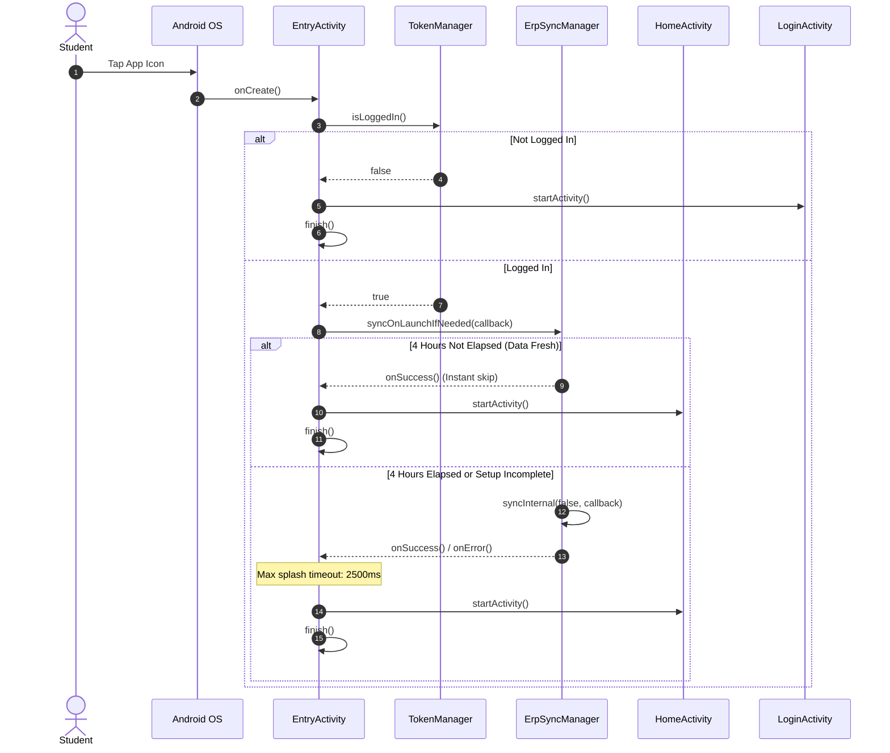
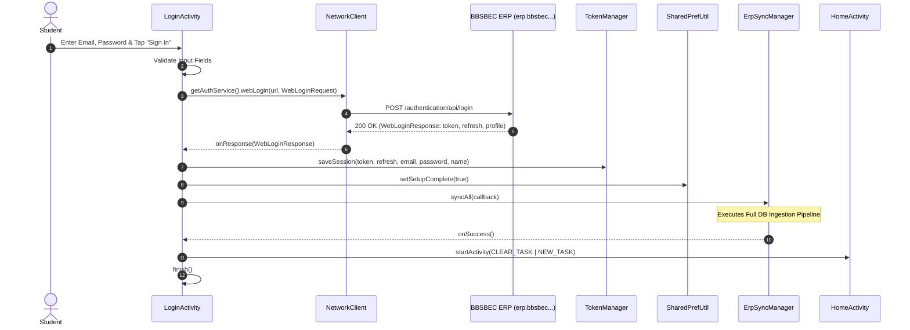
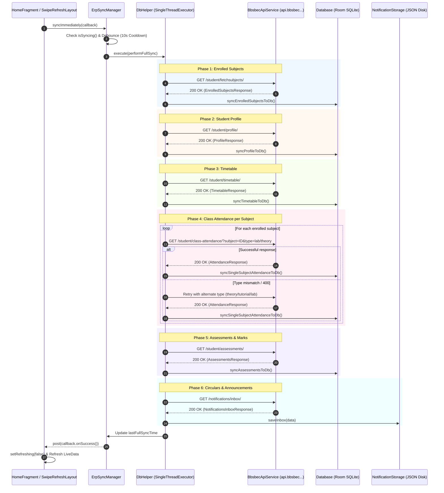
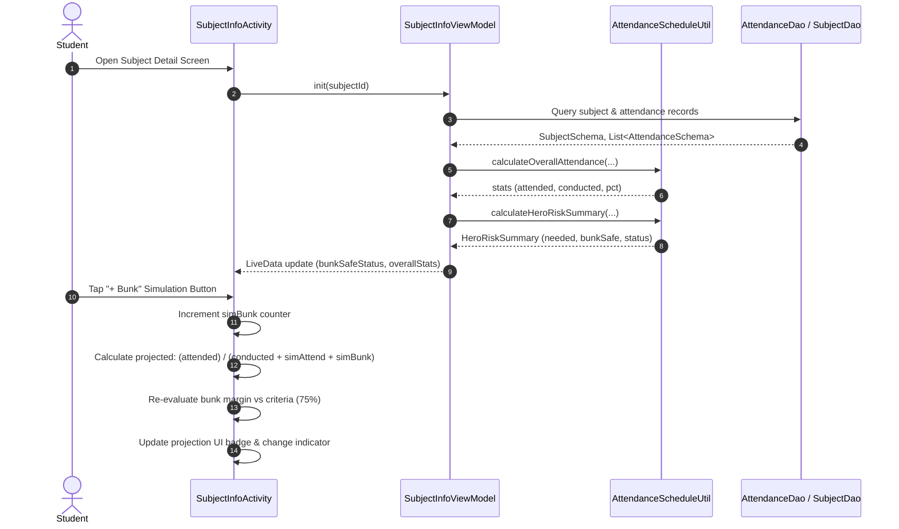
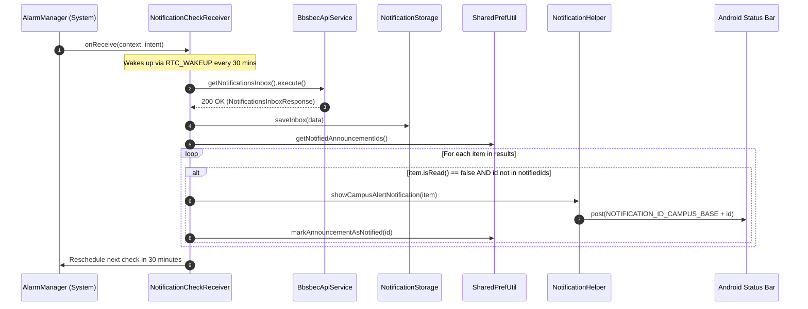
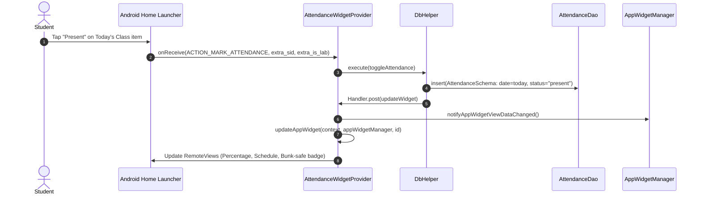

# Data Flows & Sequence Diagrams

This document illustrates the end-to-end runtime data flows for all primary user journeys using GitHub-flavored Mermaid sequence diagrams.

---

## 1. Cold Start & Session Routing Flow

Triggered when the student launches the app from the Android home screen launcher.

---

## 2. Student Authentication & Initial ERP Hydration

Occurs when an unauthenticated student submits their BBSBEC email and password.

---

## 3. 4-Hour Background & Pull-to-Refresh Sync Engine

The comprehensive data synchronization pipeline orchestrated by `ErpSyncManager`.

---

## 4. Safe-to-Bunk Attendance Simulation Journey

How `SubjectInfoViewModel` and `AttendanceScheduleUtil` compute real-time margins and forecast consequences when the student experiments with what-if scenarios.

---

## 5. Periodic Background Announcement Alert Flow

Executes automatically in the background even if the application process has been terminated.

---

## 6. Home Screen App Widget Action & RemoteViews Flow

Executes when the student taps an action button directly on the Android home screen launcher widget.

